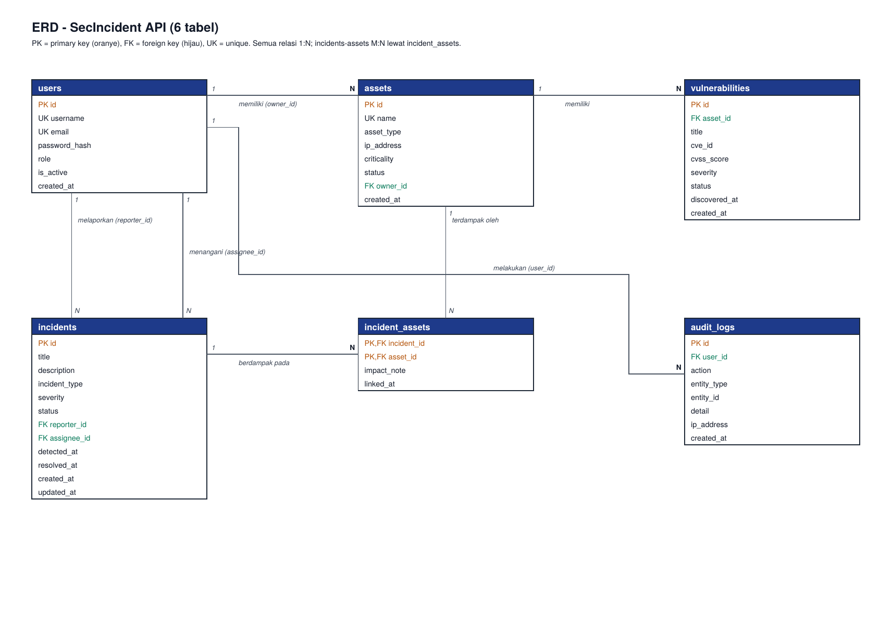
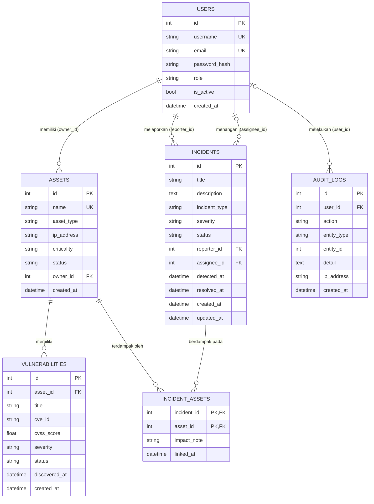

# ERD - SecIncident API

Diagram Mermaid (dirender otomatis oleh GitHub):

Catatan: `UNIQUE(asset_id, cve_id)` pada `vulnerabilities`; semua kolom enum dijaga `CHECK constraint`;
foreign key memakai `ON DELETE RESTRICT` (kecuali `incident_assets.incident_id` = `CASCADE`).
